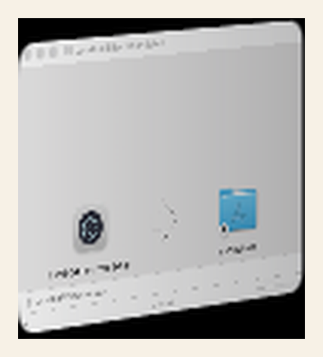
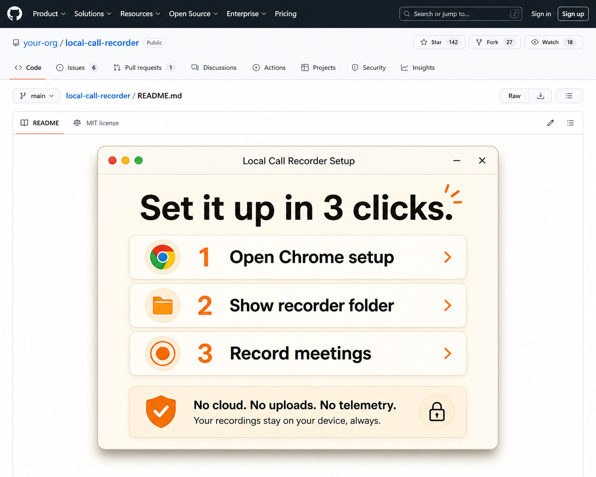
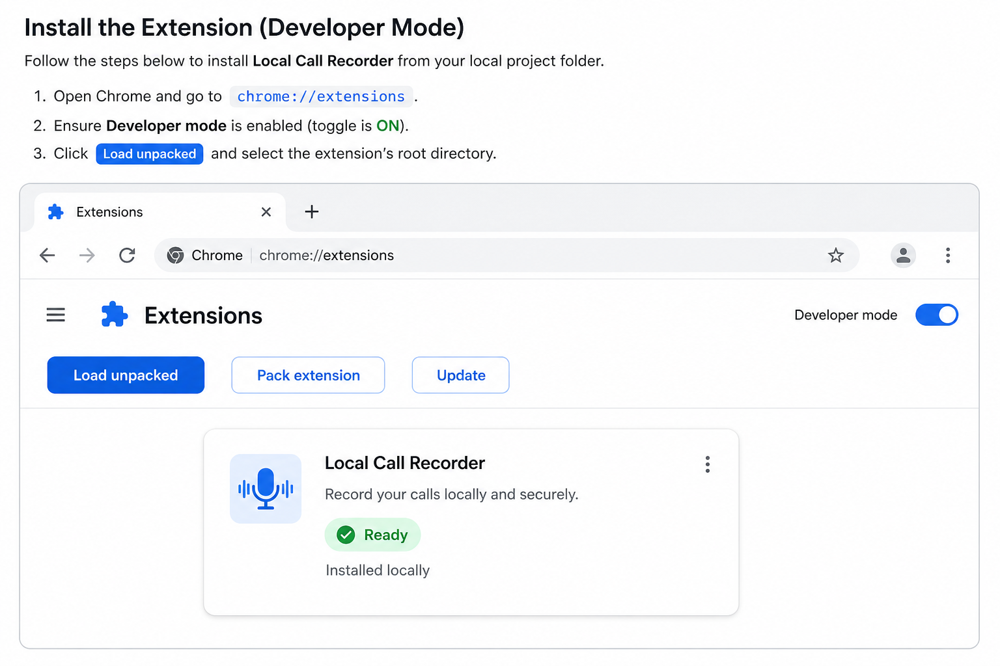
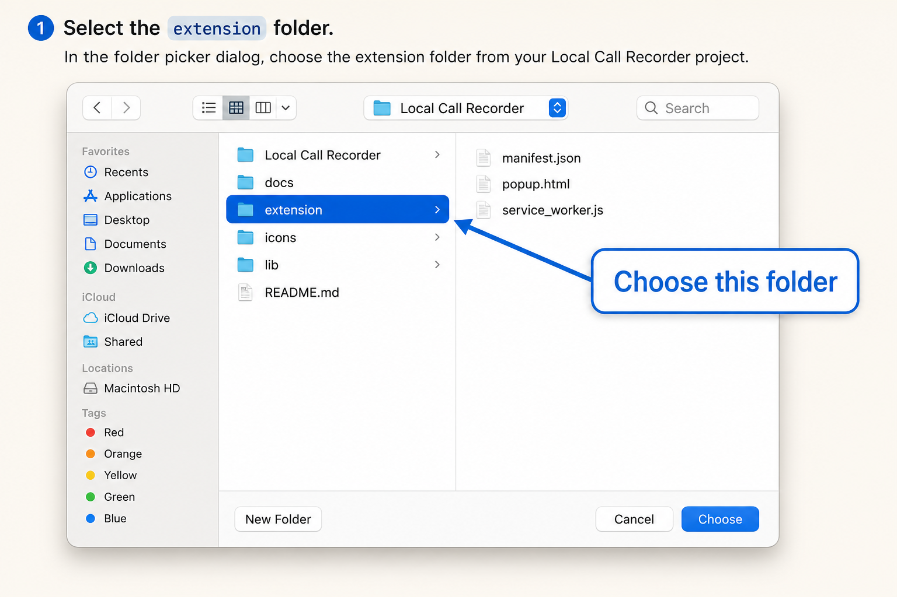

# Local Call Recorder

Local Call Recorder is a Chrome Manifest V3 extension for recording Google Meet
and Microsoft Teams calls on Windows and macOS. It saves call recordings and
caption transcripts to the device through Chrome Downloads.

The project is built for local-only data handling. It has no cloud backend, no
analytics, no telemetry, no hidden upload path, and no remote transcription API.

## Download installers

Download the current pilot installers from the
[Local Call Recorder v0.1.0 release](https://github.com/ZombieDuckling/local-call-recorder/releases/tag/v0.1.0):

- macOS Apple Silicon: `Local-Call-Recorder-Setup-macOS-arm64.dmg`
- Windows installer: `Local-Call-Recorder-Setup-Windows-x64-installer.exe`
- Windows portable app: `Local-Call-Recorder-Setup-Windows-x64-portable.exe`

The installers are unsigned pilot builds. macOS Gatekeeper and Windows
SmartScreen warnings are expected until production signing is added.

> **Warning:** Recording calls can create legal and privacy obligations. You must
> have a lawful basis, notify participants where required, and handle exported
> files according to POPIA and any other applicable law or workplace policy.

## Mac install walkthrough

These illustrated walkthrough images show the macOS installer flow. A non-technical user does
not need Terminal or GitHub.

1. Open the DMG installer.

   

2. Open **Local Call Recorder Setup**. The helper gives three large buttons.

   

3. Click **Open Chrome setup**. Chrome opens the extensions page.

   

4. Click **Show recorder folder** and choose the highlighted `extension` folder
   when Chrome asks which folder to load.

   

## What it records

The extension captures the active Meet or Teams browser tab after you press
**Start local recording**. It can optionally include your microphone audio after
Chrome shows the local microphone permission prompt.

The extension also captures visible live captions from the meeting page and
exports them as Markdown.

## Current export format

Chrome's built-in `MediaRecorder` API records the call as `WebM` on most Chrome
builds. The repository includes a local conversion script that turns `WebM` into
`MP4` with `ffmpeg` after recording.

Transcripts export as Markdown. You can convert Markdown to PDF locally with the
included script if `pandoc` is installed.

No file leaves your device unless you manually share the exported files.

## Install without Terminal

Use the desktop setup helper for non-technical users. The helper is packaged as
macOS and Windows installers through GitHub Actions.

A user follows this path:

1. Download the macOS DMG or Windows installer from the release artifacts.
2. Open **Local Call Recorder Setup**.
3. Click **Open Chrome setup**.
4. Click **Show recorder folder**.
5. In Chrome, click **Load unpacked** and select the highlighted `extension`
   folder.
6. Pin **Local Call Recorder** from the Chrome extensions menu.

No terminal is required.

> **Note:** Chrome does not allow normal consumer installers to silently install
> unpacked extensions. The setup helper gets the user to the one required Chrome
> approval step. For true one-click public distribution, publish the extension in
> the Chrome Web Store. For managed devices, use Chrome enterprise policy.

## Install manually for development

Use these steps only if you're working on the source code:

1. Download or clone this repository.
2. Open `chrome://extensions` in Chrome.
3. Enable **Developer mode**.
4. Click **Load unpacked**.
5. Select the `extension/` folder from this repository.
6. Pin **Local Call Recorder** from the Chrome extensions menu.

## Record a call

Use these steps in Google Meet or Microsoft Teams:

1. Join the call in Chrome.
2. Turn on live captions if you want transcript capture.
3. Open the extension popup.
4. Complete the consent and POPIA checklist.
5. Optional: select **Include my microphone audio**.
6. Click **Start local recording**.
7. Click **Stop + export** when the call ends.
8. Find files in your Chrome Downloads folder under `Local Call Recorder/`.

## Convert WebM to MP4 locally

Run the conversion script after recording:

```bash
node scripts/convert-webm-to-mp4.mjs "~/Downloads/Local Call Recorder/input.webm"
```

The script writes an `.mp4` file next to the source file. It requires `ffmpeg` on
`PATH`.

## Convert Markdown to PDF locally

Run the transcript conversion script after exporting a transcript:

```bash
node scripts/convert-md-to-pdf.mjs "~/Downloads/Local Call Recorder/transcript.md"
```

The script writes a `.pdf` file next to the source file. It requires `pandoc` on
`PATH`.

## Local-only assurance

The static policy test fails the build if extension source contains these network
or tracking primitives:

- `fetch(`
- `XMLHttpRequest`
- `WebSocket`
- `sendBeacon`
- common analytics SDK names
- `http://` or `https://` endpoint literals outside the allowlisted Meet and
  Teams host permissions in `manifest.json`

This is not a substitute for a legal audit, but it gives a repeatable technical
check that the extension does not contain obvious data exfiltration paths.

## Limitations

This project is intentionally conservative.

- It does not bypass Meet or Teams controls.
- It does not secretly record. The popup requires an explicit checklist and the
  page shows a visible local recording banner.
- It does not provide cloud transcription.
- It captures captions that are visible in the meeting UI. If captions are off,
  the transcript export can be empty.
- It records as WebM first because that is what Chrome exposes reliably. Convert
  to MP4 locally with the included script.

## POPIA handling notes

The extension helps with data minimisation and security by keeping processing on
the device. POPIA compliance still depends on how you use the tool.

You remain responsible for:

- lawful basis or consent;
- participant notice;
- purpose limitation;
- retention limits;
- secure storage;
- access control;
- deletion when the file is no longer needed; and
- safe sharing of exported Markdown, PDF, WebM, or MP4 files.

## Development

Run the static checks:

```bash
npm test
```

Package the extension:

```bash
npm run package
```
